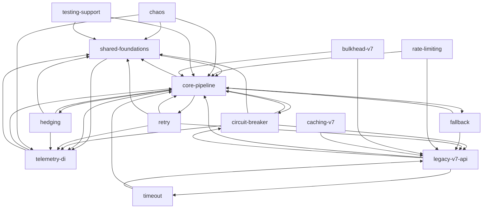

# Evidence: structure

Scope: tracked `src/**/*.cs` production code (380 files; Snippets excluded). Raw data: `.work/edges-csharp.csv` (1288 file edges), `.work/edges-csharp-sourcelink.csv` (10), `.work/metrics-cap.md`, `.work/cap-graph.mmd`.

## Graph sources
| Language | Source | Level | Confidence | Blind spots |
|---|---|---|---|---|
| C# (src), project level | csproj `ProjectReference` / `InternalsVisibleToProject` / linked `Compile Include` (read with grep) | 1-2 (the repo's own build graph) | high | no file detail |
| C# (src), file level | own script: declared type names -> identifiers used in other files, resolved to the declaring file (same project first, else referenced project), folded with `graph-metrics.mjs` | 4 (universal fallback), confidence low-medium | edges over-approximate | name-based: a same-named identifier (member, namespace segment) can match a type; partial classes resolved to the file named `<Type>.cs`; no `using static`, extension-method, overload or alias resolution; DI/reflection invisible; C# has no type-only marker, so all edges are `runtime` |
| F# / VB samples | not analysed | unknown | - | `samples/Intro.FSharp`, `samples/Intro.VisualBasic` |
| Tests, bench, samples | project references only | 1 | high (project level) | test->src file edges not computed |

Project graph (evidence): `Polly.Core` references nothing; `Polly`, `Polly.Extensions`, `Polly.RateLimiting`, `Polly.Testing` each reference only `Polly.Core`. `Polly.Extensions` and `Polly.RateLimiting` also compile 4 and 2 files from Polly.Core by source link (Guard, ObjectPool, ValidationHelper, ResilienceValidationContext, ExceptionUtilities). `Polly` (v7) and `Polly.Extensions`/`RateLimiting` never reference each other. `Polly.Core` grants InternalsVisibleTo to Polly.Core.Tests, Polly.Core.Benchmarks, Polly.Testing, Polly.TestUtils; `Polly` to Polly.Specs only. Samples consume NuGet packages, not project references (`PackageReference Include="Polly.Core"`).

## Capability graph
Cross-capability file edges: 569 of 1288; 14 nodes, 45 capability edges. Ca = capabilities depending on it, Ce = capabilities it depends on (tool output, runtime edges). Caveat: each strategy capability (retry, circuit-breaker, timeout, fallback, rate-limiting) merges v8 code (`src/Polly.Core/X`) and v7 code (`src/Polly/X`); edges to `legacy-v7-api` come from the v7 side only (inference from paths; v8 cannot reference `Polly` by project graph).

| Capability | Ca | Ce | Instability |
|---|--:|--:|--:|
| core-pipeline | 12 | 6 | 0.33 |
| shared-foundations | 10 | 3 | 0.23 |
| telemetry-di | 9 | 2 | 0.18 |
| legacy-v7-api | 7 | 3 | 0.30 |
| circuit-breaker | 3 | 4 | 0.57 |
| retry / timeout / fallback | 1 each | 4 | 0.80 |
| hedging | 1 | 3 | 0.75 |
| rate-limiting | 0 | 4 | 1.0 |
| chaos, bulkhead-v7, caching-v7, testing-support | 0 | 1-3 | 1.0 (entry candidates) |

Heaviest file-edge counts between capabilities: circuit-breaker->legacy-v7-api 61, core-pipeline->shared-foundations 46, chaos->core-pipeline 38, shared-foundations->core-pipeline 35, retry->legacy-v7-api 33, fallback->legacy-v7-api 31.

Simplified: strategy->shared-foundations/telemetry-di edges for timeout, fallback and rate-limiting are omitted for readability; full list in `.work/cap-graph.mmd`.

## Blast radius per capability
Counts are files; high-criticality set from the scan contract.
- **core-pipeline** (high): incoming from 12 of 13 other capabilities. Hubs: `ResilienceContext.cs` Ca 79, `Outcome.cs` Ca 59, `ResiliencePipeline.cs` Ca 21. Outgoing: shared-foundations 46, telemetry-di 8, 1-2 each to retry/fallback/hedging/circuit-breaker. NuGet consumers: unknown (external).
- **retry / circuit-breaker** (high): outgoing to core-pipeline, shared-foundations, telemetry-di (plus legacy-v7-api for the v7 half). Incoming is small: circuit-breaker Ca 3 (`RegistryPipelineComponentBuilder`, `PredicateBuilder.Operators`, `PipelineComponentFactory`, plus v7 type forwards); retry Ca 1 (`PredicateBuilder.Operators`). Inference: a change inside a strategy mostly stays local; what it shares outward is `*PredicateArguments`, `CircuitState`, exceptions.
- **telemetry-di** (high): Ca 9; strategies and chaos emit through `ResilienceStrategyTelemetry` (Ca 19) and `ResilienceEventSeverity` (Ca 18). File edges in: core-pipeline 8, shared-foundations 9, chaos 8, hedging 5, retry 3, circuit-breaker 2.
- **legacy-v7-api** (high): `Context.cs` Ca 99 (largest in repo), `Policy.cs` 43, `PolicyBuilder.cs` 27. A change there reaches every v7 policy (retry, circuit-breaker, timeout, fallback, rate-limiting, bulkhead, caching) and is invisible to v8.
- **platform-infra, docs-planning**: not in the C# type graph (not applicable / unknown).

## Cycles
Capability level: the tool reports one 9-node cycle (circuit-breaker, core-pipeline, fallback, hedging, legacy-v7-api, retry, shared-foundations, telemetry-di, timeout). Inference: an aggregation artefact of capabilities mixing v7 and v8 code and of core-pipeline, shared-foundations and telemetry-di living in one assembly. File-level SCCs (8, all runtime, all inside one assembly); smallest real loops:
- `ResilienceContextPool.cs` <-> `ResilienceContextPool.Shared.cs` (partial class).
- `ResiliencePipeline.cs` <-> `Utils/Pipeline/ComponentDisposeHelper.cs`; `Registry/ResiliencePipelineRegistry.cs` <-> `.TResult.cs`; `CompositeComponent.cs` <-> `CompositeComponentDebuggerProxy.cs`; `Polly/Timeout/TimeoutEngine.cs` <-> `TimeoutPolicy.cs`; `CancellationTokenSourcePool` 3 files (partial/nested).
- 3-file loops: `ResiliencePipelineBuilder.cs` / `ResiliencePipelineBuilderBase.cs` / `Utils/Pipeline/PipelineComponentFactory.cs` (the only core-pipeline <-> shared-foundations loop); `CircuitBreaker/Health/{HealthMetrics,RollingHealthMetrics,SingleHealthMetrics}.cs` (base class + subclasses).
No cross-project cycle (project references are acyclic). Inference: no architectural cycle.

## Broken boundaries
Intended layering (inference): foundations (Utils, LegacySupport) -> core-pipeline contracts -> telemetry -> strategies -> chaos/testing/DI. Runtime edges against it:
- shared-foundations -> telemetry-di: 9 edges, all from `Utils/Pipeline/{CompositeComponent,PipelineComponentFactory,ReloadableComponent}.cs`; shared-foundations -> circuit-breaker 1 (`PipelineComponentFactory` -> `CircuitBreaker/Controller/ScheduledTaskExecutor.cs`). Inference: `Utils/Pipeline` is core engine code, so shared-foundations is partly mis-bucketed.
- core-pipeline -> strategies (5 edges): `PredicateBuilder.Operators.cs` references the Retry/Fallback/Hedging/CircuitBreaker `*PredicateArguments`; `Registry/RegistryPipelineComponentBuilder.cs` -> `ScheduledTaskExecutor.cs`. The engine knows 4 concrete strategies.
- legacy-v7-api -> circuit-breaker/timeout/core-pipeline: from `src/Polly/Properties/AssemblyInfo.cs` (5 `TypeForwardedTo` into Polly.Core); a deliberate public-contract bridge.
- bulkhead-v7 -> core-pipeline: `BulkheadRejectedException` -> Core `ExecutionRejectedException` (1 edge), deliberate bridge.
- chaos (Simmy) sits inside Polly.Core with no assembly boundary: 38 edges to core-pipeline, 8 to telemetry-di (evidence: path).

## Test risks
Evidence: only NSubstitute is declared (Directory.Packages.props). Test files using `Substitute.For`/`Mock<`: Polly.Core.Tests 15/148 (CircuitBreaker 3/18, Utils 6/19, Retry 1/8, Timeout 1/7, Hedging 0/14, Fallback 0/5, Simmy 0/38, Telemetry 0/6), Polly.Specs 3/135, Polly.Extensions.Tests 4/18, Polly.RateLimiting.Tests 3/6.
- Inference: v8 strategies are testable in isolation (they pull context/outcome/telemetry only). Circuit-breaker is heavier (`CircuitStateController.cs` Ce 14, TimeProvider, scheduled tasks).
- Inference: telemetry-di (`TelemetryListenerImpl.cs` Ce 16) needs DI/metrics/logging integration tests; hedging (`TaskExecution.cs` Ce 14) needs concurrency tests.
- v7 half: tests are policy-level with little mocking; everything funnels through `Context`/`Policy` (Ca 99/43), so regressions fan out.
- InternalsVisibleTo into Core.Tests/Testing/TestUtils means tests bind to internals (evidence).

## Centres and thin entry points
- Load-bearing contracts (high Ca, low instability): `Polly/Context.cs` 99, `Polly.Core/ResilienceContext.cs` 79, `Outcome.cs` 59, `Policy.cs` 43, `CircuitState.cs` 21. `Utils/Guard.cs` (45) is a helper; fan-in is cheap (rule 2), not ranked.
- Entry candidates (Ca 0): rate-limiting, chaos, bulkhead-v7, testing-support, caching-v7. rate-limiting and testing-support are separate assemblies; the others are leaf features.
- Inference from names: public v8 entry points are `*ResiliencePipelineBuilderExtensions` that delegate to strategies (thin). The core is `ResiliencePipelineBuilderBase` (Ce 14).
- Highest-Ce files: `Polly.Extensions/Telemetry/TelemetryListenerImpl.cs` 16; `CircuitStateController.cs`, `TaskExecution.cs`, `ResiliencePipelineBuilderBase.cs`, `RetryResilienceStrategy.cs` 14 each.

## Mechanical signals
- Type-forward bridge `src/Polly/Properties/AssemblyInfo.cs` (5 forwards) explains the legacy-v7-api -> circuit-breaker/timeout edges (rules 1/2).
- Source-linked files: 10 edges from Polly.Extensions (8) and Polly.RateLimiting (2) to Polly.Core helpers, compiled into both assemblies; invisible to ProjectReference. Kept in a separate CSV, not in the capability metrics.
- Partial-class pairs account for most of the 8 file cycles.
- Type-only and build edges: none distinguishable (no marker in C#; no dist/build edges in src).
- Unmapped files in the src graph: 0.

## Unknowns
- Runtime coupling: DI registration (`AddResiliencePipeline`), reflection/`typeof` (13+ src files incl. registry and builders), source generators, telemetry listeners resolved at runtime. None are in the graph.
- External consumers of the public API / NuGet packages: unknown (external).
- File edges are name-based approximations (no Roslyn); precision not measured. A Roslyn-based tool (dotnet-deptree, NDepend) would improve it; not installed.
- test->src file edges, F#/VB samples, bench not graphed.
- v7 and v8 are merged inside each strategy capability; a per-era graph needs capabilities.tsv split into `src/Polly/X` and `src/Polly.Core/X`.

## Commands
- `git ls-files '*.csproj'`; grep for ProjectReference / InternalsVisibleToProject / Compile Include in csproj
- `python -I edges.py` (type-name edge extraction) and `an.py` (SCCs, capability pair counts, top Ca/Ce), both in the session scratchpad
- `node .claude/skills/10x-repo-map/scripts/graph-metrics.mjs edges-csharp.csv --modules capabilities.tsv --kind runtime [--unmapped group] [--emit mermaid]`
- `git grep` for mock usage, reflection, TypeForwardedTo
