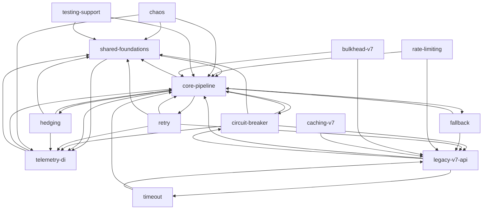

# Project Map: Polly

## TL;DR

Polly is a .NET resilience library. It ships two generations side by side. The v8 engine in `Polly.Core` composes **resilience pipelines** from strategies: retry, circuit breaker, timeout, fallback, hedging, rate limiting and chaos injection ("Simmy"). `Polly.Extensions` adds telemetry and dependency injection. The v7 `Polly` package keeps the legacy policy API alive and forwards some types into Core. Almost everything depends on **core-pipeline** (12 of the other 13 capabilities), so that is where a change reaches furthest. The buzz is **historical**: the whole repo peaked during the v8 build in 2023Q2–Q4 and is in maintenance mode. Only platform/CI work stays busy, and in the last two years one maintainer made 70–100% of every capability's commits. The risk zones are core-pipeline, circuit-breaker, retry and telemetry-di. Two things look scary but are mostly mechanical: the high fix share in v7 and the large platform/docs volume.

Source: `evidence/3-structure.md` (capability graph from the structure agent, simplified there for readability). Edges are file-level type references folded to capabilities (low-medium confidence). Each strategy capability mixes v8 code (`src/Polly.Core/X`) and v7 code (`src/Polly/X`), and the edges to `legacy-v7-api` come from the v7 half.

## Terrain

Buzz families: **chg** = change, **fix** = real fix pressure, **fric** = friction (rejected design PRs, second attempts), **att** = attention (design threads), **reach** = runtime blast radius. Values are relative to the other capabilities (H/M/L). Trend is the last four quarters against the 2023 peak. Sources: `1-history.md`, `2-discussion.md`, `3-structure.md`.

| Capability | What it does | Criticality | chg | fix | fric | att | reach | Trend | Lives in |
|---|---|---|---|---|---|---|---|---|---|
| core-pipeline | v8 pipeline engine: builder, context, outcome, registry | **high** (core value, everything depends, public API) | H (1325 changes, 285 commits) | L (8% raw) | H (10 non-sweep rejected PRs) | H (API review threads) | **H** (Ca 12) | fading, 10 commits in the last 4 quarters | `src/Polly.Core/*.cs`, `Registry/`, `test/Polly.Core.Tests` |
| circuit-breaker | breaker state machine and manual control | **high** (core value, concurrent state) | H (833) | **H** (7 behavioural fixes incl. 2026-03 deadlock) | M | L | M (Ca 3, but Ce 14 in the controller) | fading | `*/CircuitBreaker` |
| retry | retry, backoff, jitter, delay generators | **high** | M-H (669) | **H** (overflow, negative delay, cancellation) | **H** (#2396, #2829, #3135 rejected) | M | L (Ca 1) | fading | `*/Retry` |
| telemetry-di | metrics, logs, events, `AddResiliencePipeline` | **high** (all strategies emit through it) | H (725) | M | M | L | **H** (Ca 9, `ResilienceStrategyTelemetry` Ca 19) | fading | `src/Polly.Core/Telemetry`, `src/Polly.Extensions` |
| legacy-v7-api | v7 `Policy`, `Wrap`, `NoOp`, context, v7 registry, bridge | **high** (large installed base, public API) | M (824, campaign-driven) | mechanical (see below) | L | L | **H** (`Context.cs` Ca 99, the largest in the repo) | seasonal, now fading | `src/Polly` (non-strategy), `test/Polly.Specs` |
| hedging | redundant/delayed attempts (v8 only) | medium | M (531, 98 commits) | M (race and cancellation fixes 2023–24) | L | L | L (Ca 1) | fading (born 2023Q2) | `src/Polly.Core/Hedging` |
| chaos | Simmy fault, latency, outcome and behavior injection | medium | M (469, seasonal) | L | L | **H** (API threads of 80–99 comments) | L (Ca 0) | seasonal (2024Q1), now quiet | `src/Polly.Core/Simmy` |
| rate-limiting | v8 strategy plus v7 policy | medium | M | L | L | L | L (Ca 0) | fading | `src/Polly.RateLimiting`, `*/RateLimit` |
| timeout | optimistic and pessimistic timeouts | medium | L-M | L | L | L | L | fading | `*/Timeout` |
| fallback | substitute outcome on failure | medium | L-M | L | L | L | L | fading, 0 commits in the last 4 quarters | `*/Fallback` |
| caching-v7 | v7 cache policy | low-medium | L | L (mechanical) | L | M (v8 caching demand, #1127) | L | seasonal | `src/Polly/Caching` |
| bulkhead-v7 | v7 concurrency isolation | low-medium | L | L | L | L | L | seasonal | `src/Polly/Bulkhead` |
| testing-support | Polly.Testing helpers | low | L | L | L | L | L | quiet | `src/Polly.Testing` |

Non-business buckets:
- **platform-infra**: CI workflows, Cake/build, analyzers, signing, mutation testing, benchmarks. 11.8% of changes, and the only area still busy (45 commits in the last four quarters). Criticality is high, because it can break releases and package signing. Its buzz is CI trial and error, so it is mechanical (see Looks hot, is not).
- **shared-foundations**: `Utils`, `LegacySupport` polyfills, `Polly.TestUtils`. 6.7%. Partly mis-bucketed (see Real couplings).
- **docs-planning**: docs site, README, CHANGELOG, snippets, samples. 7.7%.

Folder structure against capabilities:
- Strategies span two folders each, `src/Polly.Core/X` for v8 and `src/Polly/X` for v7. The test projects are split the same way.
- `src/Polly.Core/Utils/Pipeline` is core engine code under a "Utils" folder. The capability inventory files it under shared-foundations, and it points up at telemetry-di (9 edges).
- Chaos lives inside `Polly.Core` with no assembly boundary.
- Tests moved from `src/*.Tests` to `test/` (reorg #1289), so older history uses the old paths. The mapping folds both.

Coverage: unmapped 0.4% of 9,773 counted file changes. Catch-all buckets (platform, docs, shared) total about 26%. 1,061 counted commits after excluding 893 bots and 8 mechanical mass commits. The Copilot agent authored 1 commit, in hedging.

## Real couplings

| Coupling | Basis | Mechanical? |
|---|---|---|
| Nearly everything → core-pipeline (12 of 13). Hubs: `ResilienceContext.cs` (Ca 79), `Outcome.cs` (59), `ResiliencePipeline.cs` (21) | runtime graph, file level (low-medium) | no |
| core-pipeline ↔ telemetry-di: 87 co-change commits (confidence 0.52); strategies and chaos emit through `ResilienceStrategyTelemetry` (Ca 19) | runtime graph + co-change | no |
| core-pipeline ↔ shared-foundations: 81 co-change commits, 46 edges out, 35 in. A real loop through `ResiliencePipelineBuilder*`, `PipelineComponentFactory` | graph + co-change | no |
| The engine knows four concrete strategies: `PredicateBuilder.Operators.cs` references the retry, fallback, hedging and circuit-breaker `*PredicateArguments`. `RegistryPipelineComponentBuilder` references `ScheduledTaskExecutor` | runtime graph | no |
| `legacy-v7-api` (`Context.cs` Ca 99, `Policy.cs` 43): a change reaches every v7 policy and no v8 code | runtime graph | no |
| v7 ↔ v8 bridge: 5 `TypeForwardedTo` entries in `src/Polly/Properties/AssemblyInfo.cs`, plus `BulkheadRejectedException` → `ExecutionRejectedException` | graph | deliberate public-contract bridge |
| `Polly.Extensions` and `Polly.RateLimiting` compile 6 `Polly.Core` helper files (Guard, ObjectPool, ValidationHelper, ExceptionUtilities, ResilienceValidationContext) via source links, so the edge is invisible to project references | csproj | tooling-level |
| core-pipeline ↔ platform-infra (79) and docs ↔ platform (57) co-change | co-change | yes: csproj, `PublicAPI.Unshipped.txt`, docs build |
| Strategy ↔ strategy co-change at 0.26–0.43 (retry/timeout/fallback/circuit-breaker) | co-change | mostly sweeps (API review, analyzer fixes), not semantic dependency |
| **Cycles**: no project-level cycle. The 9-node capability loop is a grouping artefact. File level has 8 small loops (partial classes, base/subclass pairs, the builder/factory trio) | graph | mostly mechanical |

Not known:
- DI registration, reflection (13+ source files) and source generators are not in the graph. That coupling is `unknown`, not absent.
- External NuGet consumers of the public API are `unknown (external)`.
- Whether a PublicAPI baseline drift fails the build was not checked.

## Risk zones

Four capabilities qualify. The bar is high criticality with high buzz in at least two independent families.

### 1. core-pipeline (Polly.Core engine)
- **Why:** it is the load-bearing centre. Almost everything depends on it, and it drew the most design disagreement.
- **Signals (independent):** reach (12 dependents, `ResilienceContext.cs` Ca 79, `Outcome.cs` 59, `ResiliencePipelineBuilderBase.cs` Ce 14) · friction (10 rejected non-sweep PRs such as the delegate-callback and context-pool proposals; Outcome API threads #2132, #2684) · attention (V8 Public API Review threads #1233/#1507, 95 comments; 77 related issues).
- **Caveats:** change volume is the highest in the repo, but the 2023Q2 spike is the one v8-build cause that also explains its attention. It counts once. The trend is fading: 10 commits in the last four quarters.
- **Files:** `src/Polly.Core/ResiliencePipelineBuilderBase.cs`, `ResilienceContext.cs`, `Outcome.cs`, `Utils/Pipeline/PipelineComponentFactory.cs`, `Registry/ResiliencePipelineRegistry.cs`.

### 2. circuit-breaker
- **Why:** concurrent state machine with a trail of real defects, including a deadlock fix as recently as 2026-03.
- **Signals (independent):** fix pressure (Half-Open handling #1991, stack-trace growth #1878, `ScheduledTaskExecutor` deadlock 2026-03; 7 behavioural fixes) · change (833 changes, second only to core-pipeline; `CircuitStateController.cs` is the top file, with heavy test churn) · friction (calculated-break-duration PR #1715 closed unmerged after 28 comments).
- **Reach:** limited (Ca 3). Isolating `CircuitStateController` for testing looks hard (Ce 14), which is an inference.
- **Files:** `src/Polly.Core/CircuitBreaker/Controller/CircuitStateController.cs`, `CircuitBreakerResilienceStrategy.cs`, `Controller/ScheduledTaskExecutor.cs`.

### 3. retry
- **Why:** arithmetic and cancellation defects keep appearing, and design proposals keep getting rejected.
- **Signals (independent):** fix pressure (overflow with max delay #1868, negative delay #2164 in 2024-06, cancellation #2456 in 2025-02) · friction (rejected proposals #2396, #2829, #3135) · change (669 changes, `RetryResilienceStrategy.cs` is a high-fan-out file, Ce 14).
- **Caveat:** reach is low (Ca 1), so a bug here stays mostly local.
- **Files:** `src/Polly.Core/Retry/RetryResilienceStrategy.cs`, `RetryHelper.cs`, `RetryStrategyOptions.cs`, `PredicateBuilder.Operators.cs`.

### 4. telemetry-di
- **Why:** every strategy emits through it, and it is the main integration point for users (DI).
- **Signals (independent):** reach (Ca 9, instability 0.18; `ResilienceStrategyTelemetry` Ca 19) · change (725 changes, 87 co-change commits with core-pipeline) · inference: `TelemetryListenerImpl.cs` (Ce 16) needs DI and metrics integration tests.
- **Caveat:** change here is largely the same 2023 build as core-pipeline. It qualifies mainly on reach plus a still-active integration role. Real fixes are few (9 behavioural).
- **Files:** `src/Polly.Extensions/Telemetry/TelemetryListenerImpl.cs`, `src/Polly.Extensions/DependencyInjection/PollyServiceCollectionExtensions.cs`, `src/Polly.Core/Telemetry/ResilienceStrategyTelemetry.cs`.

### Watch (missed the bar narrowly)
- **legacy-v7-api** (high): the largest blast radius in the repo (`Context.cs` Ca 99). Its change and fix signals are mechanical sweeps, so it has one independent family only. Treat it as "stable but fan-out heavy". Any change there needs the full v7 specs.
- **platform-infra** (high criticality): the buzz is mechanical, but it is the only active area, and one maintainer made 121 of 128 recent commits. This is a release and signing bus-factor concern, not an instability signal.
- **hedging** (medium): real race and cancellation fixes in 2023–24 (`TaskExecution.cs`, Ce 14), but low friction and reach. Needs concurrency testing.
- **chaos** (medium): very high design attention (threads of 80–99 comments), then quiet. No assembly boundary from Core.

### Looks hot, is not
- **v7 fix share 31–38%** (legacy-v7-api, caching-v7, bulkhead-v7): of 62, 31 and 17 fix commits, 55, 27 and 15 are analyzer or style work ("Fix CA1062", 2024). Real bug fixes number 2–5.
- **Reverts:** 5 in total, all formatting reverts from Dec 2022 (or one test revert), spilling over 8–10 capabilities. **No product reverts.**
- **timeout, fallback, rate-limiting raw fix and revert counts:** spillover from the single #1319 "Alpha fixes and improvements" commit.
- **platform-infra volume** (443 commits, 217 PRs, 44 closed-unmerged): CI, signing and Stryker trial and error. Counted once, as one shared cause.
- **docs-planning** (256 commits): prose and sample churn.
- **`PublicAPI.Unshipped.txt`, csproj, `Directory.Packages.props` as top "hub" files:** API bookkeeping and package config in lockstep.
- **The 2023Q2–Q4 spike across all capabilities:** one v8 build campaign. It inflates "busy" and "planned" together.
- **Strategy-to-strategy co-change:** driven by sweeps (API review, analyzer fixes, renames).
- **Mass commits:** 8 excluded, including the file-scoped-namespaces change and its revert. That revert is formatting, not a product revert.

## Whom to ask

Baseline: 63 distinct humans in the window, but two maintainers carry about 74% of counted human commits (Martin Costello 43%, Martin Tomka 31%). Every capability has at least two people over time, and testing-support has exactly two. Concentration here is mostly a baseline effect, not an individual finding.

| Zone | Ask | Basis |
|---|---|---|
| core-pipeline, telemetry-di, retry, circuit-breaker | **martincostello** (active throughout; 25 of 30 core-pipeline and 20 of 24 telemetry-di commits in the last 24 months) | history |
| Original v8 design (core-pipeline 68%, hedging 74%, telemetry 66%, retry 53%, circuit-breaker 49%) | **martintmk** (Martin Tomka): committed only 2023-03..2024-05, so this is **history, not live ownership** | history |
| Docs, chaos | **peter-csala** (strategy docs, 20% of chaos, active 2023-09..2025-09) | history |
| Chaos design | Geovanny Alzate Sandoval (10% of chaos, 2023-09..2024-03) | history |
| legacy-v7-api, platform-infra | martincostello (34 of 34 recent v7 commits; 121 of 128 platform) | history |

Drive-by authors in the v7 areas (Simon Cropp, ZLoo, Dmitrij and others) are analyzer and style sweeps, not domain owners. Inference: the PR review load sits on the same two people (Costello 1077 and Tomka 827 review events before cleaning), so the answer to "who reviews?" is mostly the same name. This is "who touched it", not "who decides". There is no CODEOWNERS evidence.

## First day

Read in this order. Each pair gives the entry point, then where the logic actually lives.

1. [docs/migration-v8.md](docs/migration-v8.md) and [docs/pipelines/index.md](docs/pipelines/index.md): the v7 versus v8 concepts and how pipelines are meant to be used.
2. [src/Polly.Core/ResiliencePipeline.cs](src/Polly.Core/ResiliencePipeline.cs) (public entry), then [ResiliencePipelineBuilderBase.cs](src/Polly.Core/ResiliencePipelineBuilderBase.cs) and [Utils/Pipeline/PipelineComponentFactory.cs](src/Polly.Core/Utils/Pipeline/PipelineComponentFactory.cs), where the pipeline is actually assembled.
3. [src/Polly.Core/ResilienceContext.cs](src/Polly.Core/ResilienceContext.cs) and [Outcome.cs](src/Polly.Core/Outcome.cs): the two contracts with the widest fan-in (79 and 59 dependents).
4. [src/Polly.Core/Retry/RetryResilienceStrategy.cs](src/Polly.Core/Retry/RetryResilienceStrategy.cs) with [RetryResiliencePipelineBuilderExtensions.cs](src/Polly.Core/Retry/RetryResiliencePipelineBuilderExtensions.cs): the simplest full strategy, plus the thin builder extension that is the public entry. Compare it with [docs/strategies/retry.md](docs/strategies/retry.md).
5. [src/Polly.Core/CircuitBreaker/Controller/CircuitStateController.cs](src/Polly.Core/CircuitBreaker/Controller/CircuitStateController.cs) and [ScheduledTaskExecutor.cs](src/Polly.Core/CircuitBreaker/Controller/ScheduledTaskExecutor.cs): the concurrency-heavy risk zone.
6. [src/Polly.Extensions/DependencyInjection/PollyServiceCollectionExtensions.cs](src/Polly.Extensions/DependencyInjection/PollyServiceCollectionExtensions.cs), then [Telemetry/TelemetryListenerImpl.cs](src/Polly.Extensions/Telemetry/TelemetryListenerImpl.cs): the integration point and its busiest file.
7. [src/Polly/Context.cs](src/Polly/Context.cs), [Policy.cs](src/Polly/Policy.cs) and [Properties/AssemblyInfo.cs](src/Polly/Properties/AssemblyInfo.cs): the v7 fan-out hubs and the type-forward bridge to v8.
8. [src/Polly.Core/Hedging/Controller/TaskExecution.cs](src/Polly.Core/Hedging/Controller/TaskExecution.cs) and [.github/workflows/build.yml](.github/workflows/build.yml): the concurrency watch item, and the build and release pipeline (88 changes, the most-changed platform file).

For deeper work on any one area, run a focused `/10x-research` on it. The map takes no target.

## Limitations

- **Window and sources:** 2022-01-17..2026-10-17 (HEAD e48c1a57), full history is available (no shallow clone). Git plus the GitHub CLI for App-vNext/Polly. 2022Q2 and 2022Q3 have no counted commits and were not investigated.
- **Graph coverage:** C# project level is high confidence. File level is a name-based script (low-medium, precision not measured). **Not graphed:** tests, bench and samples (at file level), F#/VB samples, DI registration, reflection and `typeof` (13+ source files), source generators. A Roslyn-based tool (for example dotnet-deptree or NDepend) would close most of this gap. None was installed.
- **Capability coverage:** unmapped 0.4%. Catch-alls total about 26% of changes. The capability cut is an inference from commit vocabulary, folders, README and docs headings. Strategy capabilities blend v7 and v8 code, and the per-era split is not done.
- **Attribution limits:**
  - 262 of 906 merged PRs (29%) lack a `(#N)` in the commit subject. Per-capability PR counts are lower bounds.
  - Issue-to-capability mapping is a title regex (66 of 318 unmatched). It is low-medium confidence and for relative ranking only.
  - Fix share rests on commit subjects only. The behavioural-fix filter is a coarse regex.
  - Old `src/*.Tests` and new `test/` paths are folded at capability level but not file by file.
  - The people count is 63 humans after alias merging. The contract estimated about 55.
- **Not visible from the repo:**
  - External NuGet consumers and downstream failures.
  - Open-bug age and backlog. All 318 issues are closed (stale policy, 75 NOT_PLANNED), which may hide unresolved problems.
  - Whether the PublicAPI drift check fails the build.
  - Current team membership, who reviews and merges, CODEOWNERS, and whether Tomka and peter-csala are still involved.
  - Maintainers' private plans. No ADR, RFC or roadmap exists in the repo.
- **Project-level governance signals** (2026-08 discussions: "OSMF adoption", "Forking Polly", sponsorship and maintenance fee) point to maintainer sustainability. Only titles and comment counts were seen. The content was not read.
- **Agents:** all four evidence sub-agents completed. No failures.
- **Worth a focused investigation:**
  1. The circuit-breaker concurrency model (`ScheduledTaskExecutor`, Half-Open transitions) and its test strategy.
  2. The core-pipeline builder and factory loop, and the `Utils/Pipeline` bucket boundary.
  3. The telemetry and DI runtime wiring that the graph cannot see.
  4. The unmet v8 caching demand (#1127, HybridCache PR #2709).
  5. The release, signing and CI knowledge concentrated in one maintainer.
